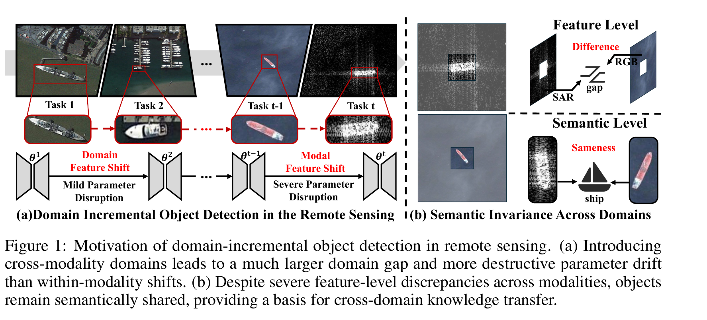
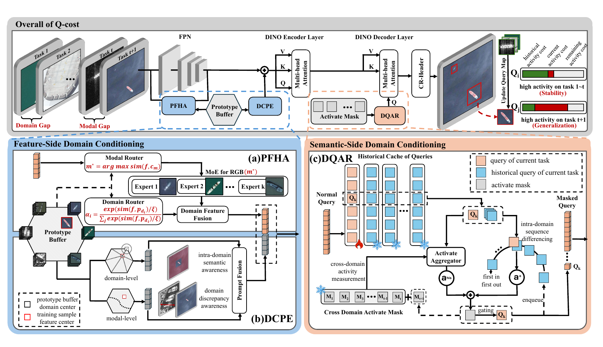
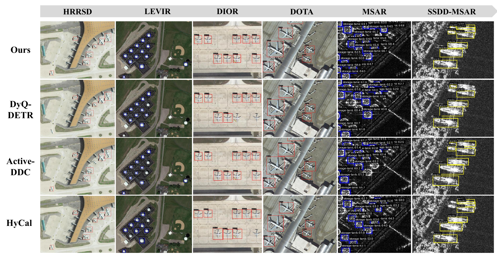

<div align="center">

# Query as a Resource

### Activity-Cost Guided Remote Sensing Domain-Incremental Object Detection

**Q-cost** &nbsp;·&nbsp; NeurIPS 2026

[](#-citation)
[](https://pytorch.org/)
[](https://github.com/open-mmlab/mmdetection)
[](https://github.com/open-mmlab/mmdetection/tree/main/configs/dino)
[](#-performance)
[](https://www.apache.org/licenses/LICENSE-2.0)

[Method Motivation](#-method-motivation) · [Architecture](#-network-architecture) · [Performance](#-performance) · [Installation](#-installation--quick-start) · [Citation](#-citation)

</div>

---

## 📄 Abstract

Remote sensing object detection often proceeds in a **domain-incremental** manner, where detectors continuously
encounter new domains arising from changes in regions, resolutions, sensors, and modalities. The challenge becomes
particularly severe when passive optical **RGB** imagery and active **SAR** (synthetic aperture radar) imagery coexist,
because their distinct imaging mechanisms create large domain gaps. Existing methods mainly rely on feature alignment or
regularization, but often overlook how object-level semantic representations are preserved across heterogeneous domains.
For DETR-like detectors, cross-domain interference can additionally disrupt decoder **queries** that serve as
object-centric semantic slots.

Under a **query-as-resource** view, we propose **Q-cost** for remote sensing domain-incremental object detection.
Q-cost contains three explicitly connected modules:

| Module | Full name | Role | Pathway |
| :--- | :--- | :--- | :--- |
| **PFHA** | Prototype-Driven Feature Homogenization Adapter | modality-/domain-aware prototypes guide a **dual-level mixture-of-experts** feature adaptation | feature side |
| **DCPE** | Domain-Context Prompted Encoder | turns the *same* prototypes into **encoder prompts** for domain-conditioned semantic aggregation | feature side |
| **DQAR** | Domain-Aware Query Activity Regulator | estimates current/historical **query activity**, models cumulative **activity cost**, and gates query updates to balance adaptation and retention | semantic side |

Experiments on multiple remote sensing benchmarks show that Q-cost improves **new-domain adaptation** and
**old-domain retention** under severe domain and modality shifts.

---

## 💡 Method Motivation

Remote sensing deployments rarely see a fixed data distribution: data streams arrive sequentially across regions,
resolutions, acquisition conditions and sensors. When the stream switches from **passive optical** sensing (texture and
color) to **active SAR** sensing (scattering and geometric responses), the distribution gap is far larger than an
ordinary intra-modality shift, and naive sequential fine-tuning overwrites earlier knowledge.

<div align="center">
  
  <br>
  <sub><b>Figure 1.</b> (a) Introducing cross-modality domains leads to a much larger domain gap and more destructive
  parameter drift than within-modality shifts. (b) Despite severe feature-level discrepancies across modalities, objects
  remain <i>semantically shared</i>, which is the basis for cross-domain knowledge transfer.</sub>
</div>

Two observations drive the design:

1. **Feature level differs, semantic level is shared.** RGB and SAR patches of the same object share almost nothing in
   appearance but share the same semantic identity — so conditioning should happen at both the feature level
   (homogenize) and the semantic level (regulate), not only by pixel/feature alignment.
2. **DETR queries are the bottleneck.** In DINO, each query `q_k` is an object-centric semantic slot: it controls how
   encoder evidence is aggregated, so *any* domain shift reaches the decoder through the change of slot responses. Under
   sequential fine-tuning, the object-grounded **Query Attention Localization Ratio (QALR)** drops from **0.68** (RGB
   checkpoint, before the RGB→SAR shift) to **0.39** after DINO fine-tuning, while Q-cost retains **0.61**
   (Hungarian-matched cross-attention inside the GT box; see Appendix F.3 of the paper).

---

## 🧠 Network Architecture

Q-cost keeps the standard DETR/DINO pipeline (`backbone → FPN → encoder → decoder`) and adds three connected modules.
The feature-side pathway *reduces the discrepancy presented to the transformer*, and the semantic-side pathway then
*regulates how the resulting evidence changes the query set*.

<div align="center">
  
  <br>
  <sub><b>Figure 2.</b> Overall framework of Q-cost. (a) <b>PFHA</b> performs prototype-guided dual-level MoE feature
  adaptation; (b) <b>DCPE</b> constructs prototype-derived prompts for domain-conditioned encoder aggregation
  (orange blocks = PFHA-adapted features, gray blocks = prototype-derived prompts); (c) <b>DQAR</b> estimates current and
  historical query activity, models activity cost, and gates query updates.</sub>
</div>
---

## 📊 Performance

<div align="center">
  
  <br>
  <sub><b>Figure 3.</b> Qualitative comparison on six domain-incremental benchmarks. Compared with three strong baselines
  (DyQ-DETR, Active-DDC and HyCal), Q-cost yields <i>fewer false positives and more stable cross-domain detections</i>,
  especially across the RGB→SAR modality shift.</sub>
</div>
---

## 🚀 Installation & Quick Start

Q-cost is implemented on top of **[MMDetection 3.x](https://github.com/open-mmlab/mmdetection)** and follows its
conventions, configs and tools. The base detector is
[`configs/dino/dino_4scale_r50_8xb2_12e_coco.py`](configs/dino/dino_4scale_r50_8xb2_12e_coco.py)
(DINO-R50, 12 epochs, batch size 2 per GPU); the hyper-parameters below assume this recipe.

This repository ships the **complete source code** of Q-cost:

| Path | Content |
| :--- | :--- |
| `module/prototype_feature_adapter.py` | **PFHA** — prototype-driven feature homogenization adapter (dual-level MoE) |
| `module/domain_context_prompt.py` | **DCPE** — domain-context prompted encoder |
| `module/query_activity_regulator.py`, `query_activity_buffer.py` | **DQAR** — domain-aware query activity regulator |
| `datasets/` | domain-incremental dataset definitions (RGB / SAR) |
| `configs/` | MMDetection-compatible configs (DINO-R50 backbone recipes) |

### 1. Environment

* Linux (recommended) or Windows, Python 3.8+
* PyTorch ≥ 1.8 + CUDA ≥ 11.x, GCC ≥ 5.4
* 2 × NVIDIA RTX 4090 (as in the paper; a single GPU works with a reduced learning rate)

```bash
conda create --name qcost python=3.8 -y
conda activate qcost
conda install pytorch==1.12.1 torchvision==0.13.1 cudatoolkit=11.3 -c pytorch
```

### 2. Install MMEngine / MMCV / MMDetection

```bash
pip install -U openmim
mim install mmengine
mim install "mmcv>=2.0.0"
```

### 3. Evaluation

```bash
python test.py configs/qcost/qcost_joint_test.py work_dirs/checkpoints/best_coco_bbox_mAP_epoch_11.pth
```

### 4. Checkpoints

The trained weights are **not** bundled in this repository (single file ≈ 751 MB, above GitHub's file-size limit).
Please place the checkpoint at the path expected by the command above:

```text
work_dirs/checkpoints/best_coco_bbox_mAP_epoch_11.pth
```

Contact [yuanzhy@stu.xidian.edu.cn](mailto:yuanzhy@stu.xidian.edu.cn) if you need the weights.

---

## 📚 Citation

If you find this work useful for your research, please cite:

```bibtex
@inproceedings{yang2026qcost,
  title     = {Query as a Resource: Activity-Cost Guided Remote Sensing
               Domain-Incremental Object Detection},
  author    = {Yang, Xi and Yuan, Zhengyu and Cheng, De and Wang, Nannan},
  booktitle = {Advances in Neural Information Processing Systems (NeurIPS)},
  year      = {2026},
  note      = {40th Conference on Neural Information Processing Systems (NeurIPS 2026)}
}
```

---

## 📬 Contact

Feel free to send e-mails to me [yuanzhy@stu.xidian.edu.cn](mailto:yuanzhy@stu.xidian.edu.cn)

## 📜 License

This repository is released under the [Apache License 2.0](https://www.apache.org/licenses/LICENSE-2.0), in line with
MMDetection. The datasets used in the paper are **not** included and remain subject to their own licenses.
